# 運用手順

## 公開先と保存データ

| 項目           | 設定                                    |
| -------------- | --------------------------------------- |
| 公開 URL       | `https://slithy.net`                    |
| 配信先         | GitHub Pages                            |
| デプロイ元     | `1.x` ブランチ                          |
| 日記データ     | Git で管理する `src/content/diary.json` |
| 利用者データ   | 収集しない                              |
| 復旧に使うもの | 検査済みの静的ファイル                  |
| 脆弱性の報告先 | GitHub Private Vulnerability Reporting  |

`/` は旧 SLITHY.NET の復元ページ、`/sasakiuri/` は個人ページ、`/sasakuri/diary/`
は日記です。個人ページの manifest と Service Worker は `/sasakiuri/` 内だけを対象にします。

## 監視と目標値

`Production monitoring`
が6時間ごとに次の項目を検査します。すべて成功した検査の割合を可用性の指標（SLI）とし、過去30日間で99%以上を目標（SLO）にします。

- トップ、個人ページ、日記、検索インデックス、manifest、robots、sitemap、Service Worker、`security.txt` が HTTP
  2xx を返す。
- 各応答を3,000 ms以内に読み終える。
- タイトル、画像、連絡先など、サイト設定に記載した内容が応答に含まれる。
- TLS 1.2以上で証明書を検証でき、有効期限が14日以上残っている。

性能は、ビルドしたファイルに Lighthouse を3回実行して中央値を確認します。Performance は0.95以上、Accessibility と SEO は1.00、LCP は2,500
ms以下、TBT は200 ms以下、CLS は0.05以下です。各上限と目標値は `config/quality-gates.json` に記載しています。

GitHub Actions の定期実行には遅延があるため、監視間隔は目安です。

## ドメインの設定

GitHub Pages の `Custom domain` に `slithy.net` を設定します。ドメインは Pages のリポジトリ設定で管理し、成果物内に
`CNAME` は置きません。

| 種別  | 名前  | 値                    |
| ----- | ----- | --------------------- |
| A     | `@`   | `185.199.108.153`     |
| A     | `@`   | `185.199.109.153`     |
| A     | `@`   | `185.199.110.153`     |
| A     | `@`   | `185.199.111.153`     |
| CNAME | `www` | `sasakiuri.github.io` |

GitHub アカウント側でドメインを検証してから DNS を切り替えます。DNS と Pages の検査が通り、証明書が発行されたら
`Enforce HTTPS` を有効にします。

## ビルドと配信

```mermaid
flowchart LR
  Source[コミット] --> Build[ビルド]
  Build --> Artifact[静的ファイル]
  Artifact --> Chromium[Chromium]
  Artifact --> Firefox[Firefox]
  Artifact --> WebKit[WebKit]
  Artifact --> Lighthouse[Lighthouse]
  Chromium --> Attestation[SBOM と生成元の証明]
  Firefox --> Attestation
  WebKit --> Attestation
  Lighthouse --> Attestation
  Attestation --> Pages[GitHub Pages]
  Pages --> Monitor[公開サイトの検査]
```



本番用ファイルを作るのは `quality` ジョブだけです。生成した `out/`
と、ファイル一覧・検査結果・ハッシュを記録した manifest を同じ Actions artifact に保存します。

manifest には次の2つの SHA-256 があります。

- `treeSha256`: ファイルごとのパス、サイズ、形式、ハッシュから計算した値
- `sealSha256`: ファイル一覧、合計サイズ、ページ、メタデータ、PWA、参照先など、`sealSha256` 以外の項目から計算した値

`sealSha256`
は形式を確認し、ジョブ出力でも後続処理へ渡します。後続ジョブは manifest を作り直さず、受け取ったファイルとハッシュが保存した値に一致することを確認してから、ブラウザーと性能のテストを実行します。

SPDX SBOM には全ファイルの SHA-1、SHA-256、package verification code を記載し、公式の SPDX
Tools で検証します。検証後の SBOM の SHA-256 もジョブ出力でデプロイ処理へ渡し、生成元の証明（attestation）を付ける直前に再確認します。

すべての検査が成功したら、同じファイルから再現可能な tar.gz を作ります。SLSA
provenance と SBOM の attestation を付け、GitHub Pages へ配信します。

`release-evidence` には tar.gz、ファイル一覧と検証用ハッシュ、SPDX
SBOM を90日間保存します。次のコマンドで、tar.gz がこのリポジトリの GitHub Actions で生成されたことを確認できます。

```sh
gh attestation verify site-export.tar.gz -R sasakiuri/sasakiuri.github.io
```

## 障害が起きたとき

1. `Production monitoring` の JSON、JUnit、ジョブのサマリーで、失敗した URL、応答時間、証明書の情報を確認します。
2. GitHub Pages Status と `Verify and deploy`
   の直近の実行結果を確認し、配信サービスと生成ファイルのどちらに問題があるかを調べます。
3. 生成ファイルに問題がある場合は、最後に配信が成功したコミットのワークフローを再実行します。ファイル一覧の SHA-256 が前回と一致することを確認して復旧します。
4. Service Worker に問題がある場合は、新しいキャッシュのバージョンを含むファイルを配信します。新しい Service
   Worker の有効化時に、古い `sasakiuri-*` キャッシュが削除されます。
5. 復旧後に `Production monitoring` を手動実行し、すべての検査が成功することを確認します。

| 重大度 | 対象                                   |
| ------ | -------------------------------------- |
| SEV-1  | サイト全体の停止、TLS の異常           |
| SEV-2  | 主要機能やオフライン表示の停止         |
| SEV-3  | 性能の上限超過、個別のメタデータの不備 |

SEV-1 と SEV-2 は、原因、影響時間、発見した方法、再発防止策を Issue に記録します。脆弱性に関する情報は公開 Issue に書かず、`SECURITY.md`
の非公開の報告先を使います。

## 日記の自動取得

`Update diary`
は毎日00時23分（日本時間）に、FxEmbed の無料・認証不要 API から投稿を取得します。変更がある場合だけ Git に保存し、配信の検査を開始します。

```sh
pnpm diary:update --dry-run
pnpm diary:update
```

`--dry-run`
は追加件数と本文の更新件数を表示し、ファイルは変更しません。最新の投稿が保存済みでも、取得した範囲内に抜けている投稿があれば追加します。

取得に失敗した場合は、公開済みのデータを変更しません。HTTP
429・5xx と通信失敗は各ページで最大3回試行します。JSON の形式、投稿者、投稿日時、カーソル、本文が検証に通らない場合は保存を中止します。FxEmbed の仕様が変わった場合は、テストデータと抽出・検証処理を更新します。

保存済みの投稿が続くページか終端に10ページ以内で到達できない場合も保存しません。長期間の停止で投稿が抜けている場合は、ブラウザーから書き出して取り込みます。ローカルで取得できた後も、Actions の実行結果を確認してください。

`Update diary` が成功しているのに公開されない場合は、`Verify and deploy`
の失敗したステップと、公開フィードの最新日時を確認します。依存監査が原因ならライブラリを修正版へ更新し、保存済みの投稿を配信します。

2026年9月には、Actions から X への直接取得が HTTP
403 で失敗しました。現在の定期取得は FxEmbed を使い、X の公開 HTML を解析していません。

### 取得環境を調べる

`Update diary` の手動実行で `diagnose`
を有効にすると、Ubuntu と macOS で取得結果を比較できます。対象は公開プロフィール、旧ドメイン、埋め込み用 URL、FxEmbed、Chromium での表示です。

診断ジョブは読み取り専用で、日記の更新や公開は行いません。各ログの HTTP ステータス、抽出エラー、投稿 ID と日時を確認してください。ジョブが完了していても、取得が成功したとは限りません。

### 過去投稿の取り込みと表示確認

README の「過去投稿を手動で取り込む」に従います。最初に `pnpm diary:import --dry-run`
で追加件数と更新件数を確認し、取り込んだ後に `pnpm build` とローカルプレビューで表示を確認します。

複数の書き出し JSON をまとめて指定できます。同じ投稿 ID に異なる本文がある場合は、どちらかを自動で選ばず、取り込みを中止します。

日記トップは最新50件、全投稿は年別ページに表示します。1ファイルが307,200
bytesを超える年は、その年だけを月別ページに分け、上限は変更しません。

投稿を追加した後は、次の操作と内容を確認します。

- 全件検索、候補の上下キー操作、検索件数、一致した語の強調表示
- 曖昧検索、引用符、除外、`OR` を使った検索
- 年と期間の絞り込み、並び順、10・25・50・100件の切り替え、条件の解除、前後のページへの移動
- 条件を含む URL の再読み込みと、ブラウザーの戻る・進む
- 検索データを取得できない場合の最新50件の表示と、再読み込みによる復旧
- `/sasakuri/diary/feed.xml` が Atom で取得でき、最新50件以下であること
- フィードのリンクが年別ページ内の記事を指し、元投稿の URL を含まないこと
- 年別ページの月別目次、各記事への固定リンク、本文とページ上部へのリンク
- `archive.txt` と `search-index.json` に全件数と最新の本文が含まれ、元投稿の URL がないこと

## 依存関係の更新

Dependabot が npm、GitHub Actions、Dev Container の更新 PR を作ります。このリポジトリ内で Dependabot が作成した、`1.x`
向けの PR だけを自動マージします。

PR の最新コミットに対する `Verify and deploy`、`Security`、`PR title`
の最新実行がすべて成功したら、rebase でマージして配信の検査を開始します。いずれかが未実行、実行中、失敗の場合はマージしません。

`Merge Dependabot updates` は各検査の成功後に動きます。手動実行でも既存の更新 PR を確認できます。更新 PR のタイトルは
`build(deps):` に統一します。

```sh
node scripts/merge-dependabot.mjs --dry-run
```

このコマンドは PR の状態を表示するだけで、マージや配信は行いません。

`GITHUB_TOKEN` でマージした場合は通常の push ワークフローが起動しないため、`Verify and deploy` と `Security`
を別途開始します。マージ後に開始要求が失敗した場合は、両方を `1.x` に対して手動実行します。

開発用の `braces` 3.0.3 にある脆弱性 `GHSA-vfj7-8cjw-p6xm`
は、修正版が未公開のため2026年11月3日まで監査の例外にしています。対象は Stylelint の特定の依存経路だけです。入力はリポジトリで管理する glob に限られ、本番配信には含まれません。期限までに修正版の有無を確認してください。

## その他の定期作業

- `Deep quality`: Mutation Testing と2回のビルド比較を週次で実行。
- `Security`: CodeQL、OSV、Gitleaks、zizmor、ライセンス、SBOM を週次で検査。
- OpenSSF Scorecard: リポジトリ設定と依存関係の安全性を週次で検査。
- `security.txt`: 有効期限前に更新。監視でも期限切れを検出する。
