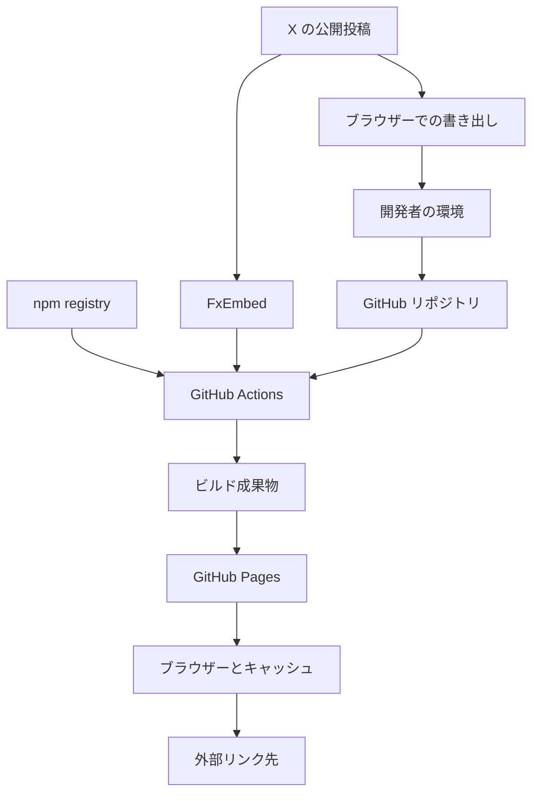

# セキュリティ上の対策と制約

## 対象

ソースの変更、GitHub Actions、ビルド成果物の受け渡し、GitHub Pages への配信、ブラウザーと Service
Worker のキャッシュを対象にします。

サイトには認証、入力を送信するサーバー、動的 API、データベース、利用者の追跡処理はありません。日記の検索はブラウザー内で行います。外部サイトへのリンクはありますが、表示時に第三者のスクリプト、CSS、フォント、画像は読み込みません。

確認するのは、表示内容と JavaScript の改変、デプロイ権限の悪用、依存パッケージの差し替え、秘密情報の公開です。復旧時には Git の履歴、SBOM、生成元の記録を使います。

## 外部入力と権限を使う箇所

外部入力は、npm から取得するパッケージ、FxEmbed の応答、X の表示内容、手動で取り込む JSON です。リポジトリへのマージ、Actions の OIDC による署名、Pages へのデプロイには、それぞれ GitHub の権限を使います。外部リンクを開くと、利用者は別のオリジンへ移動します。

## 想定する攻撃と対策

| 脅威                     | 例                                                | 対策                                                                                               |
| ------------------------ | ------------------------------------------------- | -------------------------------------------------------------------------------------------------- |
| なりすまし               | 偽の配布元や証明書でサイトを装う                  | HTTPS、TLS 証明書の監視、正規 URL、Sigstore による生成元の証明                                     |
| 改ざん                   | ビルド後に HTML、JavaScript、検査結果を差し替える | 同じビルド成果物の受け渡し、ファイルと検査結果のハッシュ、provenance                               |
| 記録の欠落               | 誰が何を配信したか分からなくなる                  | Git 履歴、デプロイ記録、OIDC attestation、90日間の記録保存                                         |
| 情報漏えい               | 秘密情報やソースマップを公開ファイルに混ぜる      | 公開ファイルの配置・拡張子の検査、Gitleaks、秘密情報に似た文字列の検査                             |
| サービス停止             | Pages の障害、巨大ファイル、壊れたキャッシュ      | ファイルサイズの上限、内容に基づくキャッシュのバージョン、監視、過去のビルドからの復旧             |
| 権限の悪用               | 不正な Action やインストールスクリプトを実行する  | ジョブごとに必要最小限の権限を設定、コミット SHA の固定、zizmor、allowBuilds、取得時の検査、CodeQL |
| XSS                      | HTML や JavaScript に不正なコードを混ぜる         | SHA-256 を指定した CSP、JSON-LD と本文のエスケープ、外部スクリプトの禁止                           |
| 元ページの操作           | 外部リンク先から元のタブを書き換える              | `ExternalLink` で `noopener noreferrer` を指定                                                     |
| 依存パッケージの差し替え | 別の配布元や URL から同名パッケージを取得させる   | lockfile、バージョン固定、Git・直接 tarball 取得の拒否、OSV、Dependabot                            |
| 日記への不正入力         | API や手動 JSON から他人の投稿や HTML を混ぜる    | 投稿者・日時・形式の検証、表示中の DOM からの収集、URL の再構成、React のエスケープ                |
| 検索データの改ざん       | 投稿を欠落させたり、異なる形式で返したりする      | 同じオリジンの固定 URL、フィールド・件数・順序の検証、CSP、成果物のハッシュ                        |
| 古いオフライン表示       | Service Worker が古いファイルを返す               | 内容に基づくキャッシュのバージョン、旧キャッシュの削除、ページ移動時のネットワーク優先             |

## 依存関係と CI の検査

Node.js、pnpm、直接依存パッケージはバージョンを固定します。pnpm は公開から24時間未満のバージョン、配布元の署名や provenance の信頼条件を満たさないバージョン、未承認のインストールスクリプト、間接依存の Git・tarball
URL を拒否します。詳しい条件は [dependency-policy.md](dependency-policy.md) に記載しています。

GitHub Actions はタグではなくコミット SHA で固定し、Dependabot で更新します。CodeQL、OSV、Dependency
Review、Gitleaks、ライセンス許可リスト、OpenSSF Scorecard でも検査します。

ブラウザーと性能のテスト、デプロイ、生成元の証明には同じビルド成果物を使います。`quality`
ジョブが作った manifest 全体のハッシュと、検証済み SBOM のハッシュをジョブ出力でも渡します。後続ジョブは環境変数を引用して検証処理に渡し、ファイルの追加・削除・内容変更、検査結果、SBOM を照合します。manifest は上書きしません。

## 外部サービスと配信先の制約

日記の定期取得は、X とは別の運営者である FxEmbed に依存します。認証情報は送りませんが、公開アカウント名と取得要求は FxEmbed に送られます。ID と日時が一致しても、本文の改変や投稿の欠落までは検出できません。サービスの停止、仕様変更、取得制限で更新できない場合は、保存済みの日記を残します。取得範囲より古い投稿の抜けは、自動取得では補えない場合があります。

GitHub Pages では、このリポジトリから任意の HTTP レスポンスヘッダーを設定できません。CSP は HTML の先頭付近に `meta`
として挿入します。`frame-ancestors`、HSTS、Permissions-Policy など、ヘッダーでの設定が必要な項目は Pages 側に依存します。Next.js のインラインスタイルを使うため、`style-src 'unsafe-inline'`
は残ります。スクリプトには `unsafe-inline` を許可せず、ビルド時に計算した SHA-256 を指定します。

GitHub、npm、ブラウザーの運営者が侵害された場合、このリポジトリの検査だけでは防げません。生成元の証明、複数の検査ツール、公開サイトの監視は、不正の発見と復旧に使います。

外部リンク先の内容や稼働状況は管理できません。リンクは利用者が操作したときだけ開き、遷移先には参照元の URL と `opener`
を渡しません。

## 日記データの扱い

X の公開 HTML は予告なく変わる可能性があります。HTML の抽出に失敗した場合は処理を中止し、保存済みの日記を上書きしません。取得するのは指定したアカウントの本文と数値 ID です。HTML、外部画像、外部スクリプトは公開ファイルへコピーしません。

### 検索と保存

全件検索用 JSON に含めるのは投稿 ID、公開日時、本文だけです。全件テキスト版も日時と本文から作り、どちらにも元投稿の URL は含めません。形式、サイズ、ハッシュを検査し、公開後の監視でも取得できることを確認します。

ブラウザーは同じオリジンの固定パスから JSON を取得し、形式のバージョン、全件数、フィールド、ID、日時、本文、重複、新しい順の並びを検証します。取得や検証に失敗した場合は全件検索に切り替えず、静的な最新50件と年別ページを残します。再取得は利用者が再読み込みを選んだ場合だけ行います。

検索語は100文字までです。引用符、除外、`OR`
は文字列として解析し、入力を正規表現として実行しません。通常の入力ではブラウザー内の処理と History
API での URL 更新だけを行います。共有 URL を開いたときは、検索条件がブラウザーの履歴や配信側のアクセスログに残る可能性があります。検索語は React のテキストとして表示し、HTML として解釈しません。

### フィード

Atom フィードは投稿 ID、公開日時、本文から最新50件を生成します。項目のリンクと識別子は、このサイトの年別ページ内の記事を指します。元投稿の URL は含めません。本文を XML 用にエスケープし、形式、サイズ、ハッシュ、公開後の取得結果を検査します。

### 手動取り込み

書き出しスクリプトは X で表示された DOM だけを読みます。Cookie、Web
Storage、IndexedDB、通信応答にはアクセスしません。出力する投稿の情報は ID と本文だけです。

取り込みファイルは1つにつき20
MB、5,000投稿までです。定義どおりのフィールド、アカウント、生成日時、数値 ID、本文の正規化、重複、新しい順の並びを検証します。同じ ID に異なる本文がある場合は取り込みを中止します。生の HTML、HAR、アカウントアーカイブは取り込みません。
